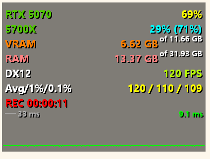

# Capture Engine

Game capture, recording, overlays, graphics overrides, and frame pacing for Windows.



CaptureEngine records game video and multiple audio sources to Matroska files, streams to YouTube, Twitch, or any
RTMP/RTMPS service, and captures in-game benchmark runs as interactive HTML reports. It records without injection
through Windows Graphics Capture (WGC) or DXGI Desktop Duplication, or through an injected, API-aware capture path
that also enables its in-game overlay, FPS limiter, and graphics overrides.

The capture, overlay, synchronization, and pacing code is developed in this repository; FFmpeg provides codec and
container support. The overlay and its frame-time graph are rendered entirely by first-party code, with no Dear ImGui
or similar library.

**[Download](https://github.com/aufkrawall/capture-engine/releases)** ·
[Technical overview](docs/technical-overview.md) · [Changelog](CHANGELOG.md) · [Security policy](SECURITY.md)

## Support

[](https://github.com/sponsors/aufkrawall)
[](https://buymeacoffee.com/aufkrawall)

Support through GitHub Sponsors or Buy Me a Coffee helps with development time, hardware, and tooling. My other
open-source projects would also profit from donations; they are listed in [Other projects](#other-projects).

## Highlights

- Non-injected WGC and DXGI Desktop Duplication capture, plus injected capture for DirectDraw, D3D6-D3D12, OpenGL,
  and Vulkan (including DXVK)
- Constant-frame-rate video with exact audio sync, checked on the finished file after every recording
- NVENC, AMD AMF, Intel Quick Sync/oneVPL, and Media Foundation encoding, with the best encoder picked per GPU
- HDR video and screenshots, with optional HDR-to-SDR tone mapping
- Multiple system-output, microphone, and per-application audio sources, mixed into separate tracks
- Live streaming to YouTube, Twitch, or custom RTMP/RTMPS through the same synchronized pipeline
- Webcam face-camera overlay composited on the GPU
- In-game overlay for DX9-DX12, Vulkan, and OpenGL with display-based frame timing, PC-latency metrics,
  frame-generation status (DLSS, FSR, NVIDIA Smooth Motion), and hardware sensors
- In-game benchmark runs with self-contained interactive HTML reports
- FPS limiter with optional NVIDIA Reflex, and capture sync that locks a game to a multiple of the recording rate
- Graphics overrides: forced anisotropic filtering and mip bias, V-Sync and queue depth, sharpening and display-gamma
  correction, DLSS presets and frame-generation controls, DLSS DLL overrides, a Streamline 1.x-to-2.x upgrade, and
  Unreal Engine 5 settings
- ReShade, OptiScaler, and Special K loaded from one folder instead of being copied into every game
- Per-application profiles, live configuration reload, a desktop recording indicator, and a best-effort privacy
  blackout
- Session logs, crash and freeze dumps, and archived matching symbols for actionable bug reports

## Requirements

- 64-bit Windows 10 or 11. WGC capture, the default, needs Windows 10 version 1903 or newer. Per-application audio
  needs Windows build 20348 or newer, which in practice means Windows 11 (or Windows Server 2022). 32-bit games are
  supported through the x86 hook.
- A GPU with a hardware video encoder: NVIDIA NVENC, AMD AMF, Intel Quick Sync/oneVPL, or a Media Foundation
  encoder.
- Administrator rights are not needed for normal use. CPU temperature, package power, and core clock need the PawnIO
  driver plus either the optional elevation service or an elevated CaptureEngine (see
  [Hardware sensors](#hardware-sensors)). `[Performance] gpu_scheduling_priority=high` or `realtime` may require
  administrator rights.
- NVIDIA Reflex limiting, the DLSS overrides, and the NVIDIA LOD-spread fix need an NVIDIA GPU.

## Installation

### Installer (recommended)

Download `captureengine-setup-<version>.exe` from the
[releases page](https://github.com/aufkrawall/capture-engine/releases) and run it. It installs to
`C:\Program Files\Capture Engine` by default and asks for administrator rights once. On a first installation the
options page preselects desktop and Start-menu shortcuts, the [elevation service](#hardware-sensors), Start with
Windows, the PawnIO sensor driver, and starting CaptureEngine when setup finishes; "always request administrator privileges" is off. Everything can be unchecked there, and the service,
autostart, administrator, and PawnIO choices can be changed later from the tray menu.

`captureengine-setup-<version>.exe --help` lists the command-line options, including `/S` for a silent installation,
`--dir=<folder>`, and `--<option>` / `--no-<option>` for `desktop`, `start-menu`, `service`, `autostart`, `admin`,
`pawnio`, and `launch`.

### Portable archive

Unpack `captureengine-<version>.7z` to a folder you can write to and start `CaptureEngine.exe`. No shortcuts,
service, or autostart entry are created; the tray menu can add the service and autostart later.

### Updating

Run the new installer over the existing installation. It closes a running CaptureEngine first; games that still have
the hook loaded keep running, and the old hook file is removed at the next restart. An existing `config.ini` is never
merged or replaced: the installer writes the new defaults next to it as `config.ini.new`. Compare the two (or the
current [template](captureengine/config.ini.template)) for newly added settings and examples. For the portable
archive, unpack the new version into a fresh folder and copy your `config.ini` across.

### Uninstalling

Remove "Capture Engine" from Windows Installed Apps. `config.ini` and the logs are kept unless "delete my settings and
logs" is ticked; recordings are never deleted.

### Verifying a download

Stable releases contain the installer, the portable archive, a separate `testapps-<version>.7z` validation bundle,
`ffmpeg-corresponding-source-<version>.7z`, and `latest_manifest.json` / `latest_summary.txt` from the full clean
build, test, lint, and sanitizer gate. Public releases carry GitHub artifact attestations, which GitHub CLI can check:

```powershell
gh attestation verify .\captureengine-setup-<version>.exe --repo aufkrawall/capture-engine
```

CaptureEngine binaries are not Authenticode-signed yet, so Windows may show a SmartScreen warning. An attestation
proves that the downloaded bytes came from this repository's release workflow; it does not make unsigned code safe.

## Quick start

1. Install CaptureEngine and start it. It runs as an icon in the notification area.
2. Press **Ctrl+9** to start recording and again to stop. Recordings go to `%VIDEOS%\Capture Engine`.
3. Left-click the tray icon to open `config.ini`, the complete settings reference. Saved changes apply while
   CaptureEngine runs; settings used to start a recording apply from the next recording.

Out of the box nothing is injected: windows are recorded through WGC and fullscreen games through DXGI Desktop
Duplication. To use the in-game overlay, FPS limiter, or graphics overrides in a game, add an [application
profile](#application-profiles), but read [Anti-cheat safety](#anti-cheat-safety) first.

### Hotkeys

| Default | Action |
| --- | --- |
| Ctrl+9 | Start or stop a recording (or a stream, when streaming is enabled). If this hotkey is cleared, F9 is used. |
| Ctrl+8 | Show or hide the in-game overlay |
| Ctrl+0 | Take a screenshot |
| Ctrl+Minus | Start or stop an audio-only recording |
| Ctrl+7 | Start, stop, or clear an in-game benchmark |

Change them under `[Hotkeys]`; combinations such as `Ctrl+Shift+F10` work.

### Tray menu

Left-click opens `config.ini`. Right-click opens the menu:

| Item | Effect |
| --- | --- |
| Open config | Opens `config.ini` |
| Install PawnIO / Uninstall PawnIO | Installs or removes the driver for CPU sensors |
| Use elevation service | Installs or removes the optional elevation service; the label shows its state |
| Always request administrator privileges (next launch) | Starts CaptureEngine elevated from the next launch on |
| Start with Windows | Starts CaptureEngine at sign-in |
| Close | Exits CaptureEngine |

### Where files go

| Output | Setting | Default |
| --- | --- | --- |
| Recordings | `[Output] output_dir` | `%VIDEOS%\Capture Engine` |
| Screenshots | `[Output] screenshot_dir` | `%VIDEOS%\Capture Engine\Screenshots` |
| Benchmark reports | `[Benchmark] output_dir` | `%DOCUMENTS%\Capture Engine Benchmarks` |
| Logs and crash dumps | - | `logs\` in the installation folder |

`%VIDEOS%` and `%DOCUMENTS%` are the Windows library folders, wherever they were moved; `%USERPROFILE%` and other
environment variables work too. An empty path uses `captures\`, `screenshots\`, or `benchmarks\` next to
`CaptureEngine.exe`.

### Command line

| Option | Effect |
| --- | --- |
| `--launch <command line>` | Starts a game with the hook in place before it runs; must come last. For Steam, set the game's launch options to `"C:\Program Files\Capture Engine\CaptureEngine.exe" --launch %command%`. A launcher executable is started normally and the game is caught when it starts. CaptureEngine must not already be running. |
| `--config=<path>` | Uses another settings file instead of `config.ini` |
| `--list-monitors` | Prints copyable stable monitor IDs for `monitor=id:<stable-id>` |
| `--auto-record=<delay ms>,<duration ms>` | Starts a recording after the delay and stops it after the duration |
| `--install-pawnio` / `--uninstall-pawnio` | Installs or removes the PawnIO driver, asking for elevation when needed |
| `--license` | Shows the license |

## Anti-cheat safety

> [!WARNING]
> Every feature that needs CaptureEngine's injected hook DLL should be treated as unsafe with anti-cheat software:
> injected capture, the in-game overlay, the FPS limiter, graphics, DLSS, and UE5 overrides, `--launch`, and loading
> ReShade, OptiScaler, or Special K. WGC or DXGI capture is non-injected only when the game's profile does not enable
> injection for another feature.

For anti-cheat-protected games, use a profile with `video_capture=wgc` (or `dxgi_dup`) and `dll_injection=never`, as
in the first [profile example](#application-profiles). This is the likely-compatible configuration, not a universal
guarantee.

- The `[DLSS]` DLL overrides (`dlss_sr_dll_path`, `dlss_rr_dll_path`, `dlss_fg_dll_path`, `streamline_dll_path`) and
  the Streamline upgrade (`streamline_upgrade`) are CaptureEngine's own injected mechanisms. They are not NVIDIA's
  official DLL-override feature and do not inherit its anti-cheat safety; the upgrade is the more invasive of the two.
- `[Graphics] nv_lod_spread_fix=on` patches the NVIDIA driver in memory inside the game. Leave it off for competitive
  online games.
- CaptureEngine registers a Vulkan layer that stays registered after it exits. The Vulkan loader therefore maps its
  small gate DLL into every Vulkan application to ask whether it should take part; the gate declines in any process
  that is not an injection target, including games whose profile sets `dll_injection=never`, and is unloaded again.
  The environment variable `DISABLE_CE_VULKAN_LAYER=1` keeps it out of a process entirely.

## Application profiles

Per-game configuration goes into small `[Profile.<name>]` blocks at the end of `config.ini`. A profile names the
executable and sets only what should differ for that game. The generated `config.ini` ends with more examples,
including side-by-side safe and unsafe ones.

For online and anti-cheat-protected games, stay non-injected. This example records `OnlineGame.exe` at 60 fps through
WGC and shows the desktop recording indicator together with its NOT RECORDING warning:

```ini
[Profile.Online Game]
process=OnlineGame.exe
video_capture=wgc
dll_injection=never
Video.fps=60
DesktopOverlay.mode=1
```

For single-player games, injection unlocks capture sync, the in-game overlay, and graphics overrides. This example
records `SinglePlayerGame.exe` through the injected hook at 60 fps with capture sync limiting the game to 120 fps
while recording, turns V-Sync off, forces 16x anisotropic filtering with a negative mip bias, and raises the game's
DLSS frame generation to 3x when the game enables it:

```ini
[Profile.Single Player]
process=SinglePlayerGame.exe
video_capture=inject
Video.fps=60
FpsLimiter.capture_sync_enabled=true
FpsLimiter.capture_sync_multiplier=2
Graphics.vsync_mode=off
Graphics.anisotropic_filtering=16x
Graphics.mip_bias=-1.5
DLSS.dlss_fg_factor=3x
```

A full-featured injected profile for STALKER 2: app audio on track 1, forced V-Sync, forced 16x anisotropic
filtering, DLSS super-resolution, frame-generation, and Streamline DLL overrides, a forced 3x DLSS FG factor and FG
preset, NVIDIA's DLSS indicator, and the full UE5 Ray Reconstruction quality bundle with RR preset E:

```ini
[Profile.stalker]
process=Stalker2-Win64-Shipping.exe
video_capture=inject
audio_enabled=true
audio_track=1
Graphics.vsync_mode=fifo
Graphics.anisotropic_filtering=16x
DLSS.dlss_sr_dll_path=C:\path\to\dlls\folder
DLSS.dlss_fg_dll_path=C:\path\to\dlls\folder
DLSS.streamline_dll_path=C:\path\to\dlls\folder
DLSS.dlss_fg_factor=3x
DLSS.dlss_fg_preset=b
DLSS.dlss_debug_overlay=on
UE5.ray_reconstruction_optimal_settings=full
DLSS.dlss_rr_preset=e
```

How profiles work:

- `process=` is either an executable name or an image-path suffix, matched case-insensitively. For example,
  `process=game.exe`, `process=Modded\game.exe`, and `process=D:\Games\Modded\game.exe` are valid. A partial path
  must start at a folder boundary, so `Modded\game.exe` does not match `NotModded\game.exe`. If both a name-only and a
  path-specific profile match, the longer path wins; otherwise the name-only profile remains the fallback. The profile
  name is only a label. UTF-8 executable names and path components, including Cyrillic and CJK text, do not depend on
  the Windows active code page. `window_title` and `window_match` can pick the right window when one process owns
  several.
- `video_capture` selects the video source for that game: `inject`, `wgc`, `dxgi_dup`, `none`, or `inherit` (the
  global `[Capture] capture_method`).
- `dll_injection` is normally left out, because injection follows the video source. `always` also injects while
  recording through WGC or DXGI, for the overlay and overrides; `never` blocks injection.
- `audio_enabled=true` records the game's own audio on `audio_track` (one ID or a comma-separated list).
- Any other setting is overridden as `Section.key=value`, for example `Video.fps=60` or `Graphics.vsync_mode=off`.

## Features

### Recording, HDR, and audio

- **Capture method:** `[Capture] capture_method=auto` (the default) uses injected capture for games whose profile
  allows it, WGC for other windows, and DXGI Desktop Duplication for fullscreen applications. `inject`, `wgc`, and
  `dxgi_dup` force one method. DXGI can fall back to WGC for the same monitor. A WGC session can make Windows switch
  to a software-rendered mouse cursor; DXGI keeps the hardware cursor.
- **Video:** recordings use a constant frame rate (`[Video] fps`, default 120). The default `[Video] encoder=auto`
  test-opens the candidates on the GPU that encodes and uses the best one that works: AV1, then HEVC, then H.264,
  through the vendor's own encoder before Media Foundation, preferring one that also encodes 10-bit/HDR. `av1_auto`,
  `hevc_auto`, and `h264_auto` restrict the codec. A named encoder such as `hevc_amf` is used as given and never
  silently switched. MKV is the default and the only actively tested container; MP4 and MOV are compatibility
  options.
- **HDR:** `[Video] color_space=auto` preserves a detected HDR source as BT.2020/PQ through HEVC or AV1.
  `color_space=bt709` performs a real HDR-to-SDR tone and gamut map calibrated from the Windows SDR-white setting
  rather than relabeling HDR pixels as SDR. Media Foundation encoders do not carry HDR.
- **Audio:** multiple system-output, microphone, and per-application sources; each source can feed one or more
  tracks, and sources sharing a track are mixed. AAC, ALAC, FLAC, Opus, and PCM are supported. Ctrl+Minus records
  audio only.
- **Sync:** audio is never cut, sped up, or moved earlier to catch up with video. Every recording is reopened after
  writing, checked for gaps, and every audio track is decoded to verify that all tracks end exactly with the video.
  A file appears under its final name only once it is complete, so an interrupted recording never leaves a broken
  file behind.
- **Encoder overload:** short overloads are absorbed by repeating frames on the constant-rate grid without breaking
  sync. Sustained overload cannot be fixed inside CaptureEngine: lower the game's GPU load or frame-rate limit, or
  reduce encoder complexity, most notably B-frames, lookahead, and multipass.

### Screenshots

Ctrl+0 saves a screenshot from injected capture or, without injection, through WGC. The default
`[Screenshot] color_space=both` saves an HDR source twice from one capture: a 10-bit BT.2020/PQ AVIF and a
tone-mapped SDR PNG with the same name. An SDR source saves one PNG. `auto` saves HDR only as AVIF, and `bt709` always
saves a tone-mapped SDR PNG.

### Live streaming

Set `[Streaming] enabled=true`, choose `service=youtube`, `twitch`, or `custom`, and copy the ingest server and stream
key from the service's encoder setup page into `server` and `stream_key`. A complete `rtmp://` or `rtmps://`
publishing URL can instead go into `url`, which takes precedence. Prefer RTMPS whenever the service offers it. The
stream key is stored in `config.ini` like a password, and logs always redact the publishing destination.

The recording hotkey then starts and stops a stream instead of a local video file; no archival file is written in
parallel, while the audio-only hotkey still writes a local MKA file. Streams use the configured hardware backend's
H.264 encoder with CBR, a two-second keyframe interval, 8-bit BT.709 4:2:0, and low-latency settings, run at no more
than 60 fps (`max_fps` can lower that), and mix all enabled audio sources into one 48 kHz stereo AAC track. For the
lowest viewer latency, also select the service's low- or ultra-low-latency mode in its creator dashboard; that buffer
cannot be chosen through RTMP.

A stalled connection stops the stream with an explicit failure after a two-second packet budget instead of blocking
capture, dropping arbitrary packets, or letting audio and video drift apart. Completion feedback says whether the
stream ended, ended with degraded video, or failed.

### Face-camera overlay

Set `[FaceCamera] enabled=true` to add the default Windows camera to recorded or streamed video. The camera runs
independently of game capture, so a slow, missing, or disconnected camera never stalls a recording, and the image is
composited on the GPU without CPU blending or readback. `config.ini` documents device selection, resolution/FPS,
anchors or custom placement, size and margin, rectangle/rounded/circle masks, crop or stretch, mirroring, opacity,
border, and the frozen-frame timeout. The camera keeps moving even when an overloaded game frame has to be repeated.

### In-game benchmark

Press Ctrl+7 in an injected game to start a benchmark. `[Benchmark] start_delay_seconds` adds an optional countdown,
and `duration_seconds=0` records until Ctrl+7 is pressed again, while a non-zero value stops automatically. Stopping
writes a self-contained interactive HTML report to `[Benchmark] output_dir`, and the overlay shows a results card until
the next Ctrl+7 press clears it. The report contains average, maximum, and minimum FPS, 1% and 0.1% low FPS, average
frame time, and the available CPU/GPU/RAM/VRAM load and hardware-sensor data. Benchmarks need injection
(`video_capture=inject` or `dll_injection=always` in the game's profile) and do not modify game files or capture
settings.

### In-game overlay

The injected overlay (Ctrl+8) shows FPS, frame time and 1% lows, a frame-time graph, CPU/GPU/RAM/VRAM load, hardware
sensors, PC latency, frame-generation status, and the recording state; `[Overlay]` sets which rows appear, the layout,
and the colors, and whether the overlay appears in recordings and screenshots. By default frame timing comes from
when frames actually reach the screen (`frametime_source=display_change`), so generated frames and variable refresh
are included; when that data is unavailable, the overlay falls back to the game's own presentation timing. The
overlay works alongside other overlays such as Steam and RTSS and with object-wrapping DX11 graphics proxies; a
combination nobody has tried yet still depends on the game, API, runtime, driver, and overlay versions involved.

### Desktop recording indicator

Without injection, a small screen-corner window can show the recording state, a NOT RECORDING warning when a profiled
game is not being captured, and encoder overload warnings. By default (`[DesktopOverlay] mode=2`) it shows only the
warning; `mode=0` shows only the recording indicator and `mode=1` both.

### FPS limiter

The FPS limiter needs injection and has two parts:

- **General limiter:** `[FpsLimiter] general_enabled=true` caps an injected game at `general_fps`, whether or not it
  is being recorded.
- **Capture sync:** `capture_sync_enabled=true` limits the game to `capture_sync_multiplier` times the recording frame
  rate while recording, so every recorded frame lines up with the video's frame grid.

Each part has a mode: `auto` (the default) uses the game's own NVIDIA Reflex when the game has turned it on and
CaptureEngine's own pacing otherwise, `basic` always uses CaptureEngine's pacing, and `reflex` drives Reflex even in
games without it on NVIDIA GPUs. With frame generation, the limit applies to the displayed frame rate.

### Graphics overrides

All graphics overrides need injection. `config.ini` lists the exact values and effects:

| Area | Settings |
| --- | --- |
| V-Sync and queue depth | `[Graphics] vsync_mode`, `cpu_prerender_limit`, `backbuffer_count` |
| Texture filtering | `anisotropic_filtering`, `sampler_override_mode`, `mip_mapping`, `mip_bias` |
| Sharpening and gamma | `sharpen` (CAS/RCAS), `display_gamma` |
| NVIDIA LOD-spread fix | `nv_lod_spread_fix` forces the High Quality (HQ) texture filtering LOD spread in Vulkan and OpenGL, where the driver erroneously keeps the Quality (Q) setting for `FERMI_UNOPT_LOD_SPREAD` even with configured HQ filtering, preventing unnecessary temporal shimmering with negative mip bias and unnecessary blur with positive mip bias (unlike D3D10, 11, and 12) |
| DLSS | `[DLSS]` super-resolution and Ray Reconstruction presets, frame-generation multiplier, mode, and preset, NVIDIA's on-screen indicator, NGX update control, DLL overrides, and `streamline_upgrade`, which runs a Streamline 2.x runtime in a game that shipped Streamline 1.x so DLSS multi-frame generation becomes available (off by default) |
| Unreal Engine 5 | `[UE5]` Ray Reconstruction with a quality bundle, depth of field, DLSS super resolution, HDR output, post-processing effects, and custom CVars |

Forced anisotropic filtering follows each API's own sampler model, and `sampler_override_mode=safe` leaves
special-purpose samplers alone. The UE5 options change engine settings in memory only and never edit `Engine.ini` or
other game files; they cannot add a plugin or feature the game does not ship.

### ReShade, OptiScaler, and Special K

CaptureEngine can load ReShade, OptiScaler, and Special K from your own folders, so they do not need to be copied into
each game. Set `reshade_dll_path`, `optiscaler_dll_path`, and `specialk_dll_path` under `[ThirdParty]` (per profile:
`ThirdParty.reshade_dll_path=...`); a folder gets `ReShade64.dll`/`ReShade32.dll`, `SpecialK64.dll`/`SpecialK32.dll`,
or `OptiScaler.dll` appended for the game's architecture. `custom_dll_paths` loads further DLLs after them. A listed
DLL named like one the game has already loaded from Windows, such as DXVK's `dxgi.dll` with vkd3d-proton's `d3d12.dll`
and `d3d12core.dll`, replaces it for the game as if it had been copied next to the game's executable. All can be
active at once. Each tool still reads its own configuration next to the game executable, OptiScaler's
`LoadReshade`/`LoadSpecialK` options should stay off, and ReShade in Vulkan games still needs ReShade's own Vulkan
layer. Changing these paths requires relaunching the game.

### Hardware sensors

CPU/GPU temperature, package power, GPU fan speed, CPU/GPU core clock, GPU memory clock, and GPU core voltage can be
added to the overlay through the bundled LibreHardwareMonitor bridge. `[HardwareSensors] enabled=auto` turns it on and
every metric defaults to `auto`; a metric can instead name an exact LibreHardwareMonitor sensor ID or be `off`. A
sensor that cannot be read stays blank instead of showing zero. No LibreHardwareMonitor code enters the game.

GPU sensors work out of the box. CPU temperature, package power, and core clock also need
[PawnIO](https://pawnio.eu/), a separate Microsoft-signed kernel driver, and one of:

- the **elevation service**, an optional Windows service that reads those sensors for CaptureEngine so it can run
  without administrator rights (offered by the installer and in the tray menu), or
- CaptureEngine running as administrator.

When the driver is missing and CPU sensors are requested, CaptureEngine asks once at startup (install now, not now, or
don't ask again) and runs the bundled, signature- and hash-verified PawnIO installer under one administrator prompt.
The tray menu and `--install-pawnio` / `--uninstall-pawnio` do the same. See the installed
`plugins\LibreHardwareMonitor\README.txt` and `config.ini` for details.

### Privacy

- **Blackout:** `[Capture] black_when_no_fullscreen_focus=true` turns WGC and DXGI video opaque black, including
  cursor and overlays, while the selected window is not focused and fullscreen-like. It uses passive window-state
  APIs only, but Windows focus detection is not 100% reliable, so it is not a guaranteed redaction boundary.
- **Logs:** account names in `\Users\<account>` paths are masked, and your recording and screenshot folders are
  shortened to drive and file name before anything reaches a log file. This is best-effort pattern matching, not a
  guarantee, and crash dumps intentionally keep full paths and memory. Review logs and dumps before sharing them.

## Configuration

There is no separate usage wiki: the generated `config.ini` documents every normal option, valid values, safety
notes, and complete profile examples. Its source is
[captureengine/config.ini.template](captureengine/config.ini.template), embedded into CaptureEngine for first-run
creation.

CaptureEngine watches `config.ini` and applies changes while it runs, for example switching the FPS limiter on or off.
Settings used when a recording starts take effect at the next recording. CaptureEngine runs capture and encoding in
separate helper processes, so a crash there cannot take the application down, and every recording starts in a fresh
process. `[Runtime] isolated_helpers=off` runs them on threads inside the application instead, the way programs that
use `cengine.dll` run them; it is read at startup.

## Logs, crash dumps, and bug reports

Every run creates a timestamped session folder under `logs\` with per-component logs, a manifest, and an immutable log
and manifest for each recording. Crash and freeze dumps go to the same folder (or to a subfolder named by
`[Logging] crash_dump_dir`) together with a copy of the matching CaptureEngine symbols, so a dump stays readable after
an update. `[Logging] log_level` defaults to `trace`, the most detailed level.

Useful, reproducible bug reports are welcome, ideally with the session folder, your `config.ini`, reproduction steps,
and dumps where available. Before uploading, check them for private data such as paths, window titles, or memory
contents, and remove anything you do not want to share. Reports are usually addressed, but this is a free-time project
with many remaining tasks: fixes may take a while, and I cannot guarantee a fix, compatibility with every
game/driver/runtime combination, or an individual reply to every report. Report security vulnerabilities privately
through the [security policy](SECURITY.md), not in a public issue.

## Known issues and limitations

- **FPS limiting with frame generation** is still incomplete and subject to change; it may not hold the intended
  cadence in every game, runtime, or frame-generation combination.
- **Frame-generation switching** (for example between DLSS and FSR frame generation) can still leave the overlay in a
  bad state. Transition tests cover the supported paths, but recovery is not guaranteed in every game, runtime,
  driver, and third-party overlay combination.
- **Display-change timing** depends on Windows and NVIDIA ETW data. When it is unavailable, denied, or stale, the
  overlay falls back to presentation timing, which cannot show the real display cadence under frame generation or
  variable refresh.
- **Classic Direct3D 9** injected capture usually falls back to a GPU→CPU readback, which is slow at high resolutions
  and frame rates (for example 4K/120) and can severely affect game performance. Running the game through DXVK avoids
  it; Direct3D 9Ex games are already fast.
- **DirectDraw and D3D6-D3D8** are tested mainly through synthetic test applications; real-game coverage so far is
  thin.
- **Installation path:** CaptureEngine cannot run from a folder whose path cannot be expressed in the Windows code page
  unless that volume has 8.3 short names.

## Possible future work

These are exploratory directions, not promises or a release schedule. Items are only implemented if they prove
feasible:

- XeSS frame generation support
- evaluating a standalone GUI or an in-overlay GUI
- D3D12VA video encoding
- additionally offering an FFmpeg Vulkan video path instead of D3D11

## For developers

### SDK

CaptureEngine's engine is `cengine.dll`, and the CaptureEngine app is one program that uses it. Every installation
contains an `sdk` folder with a C API (plus an optional C++ wrapper), import libraries for clang/MinGW and MSVC, a
CMake package, and a headless example, so other programs can start the engine, record, take screenshots, change
settings, and receive events. A client must live in the CaptureEngine folder next to `cengine.dll`, and only one
engine runs per Windows session. See [sdk/README.md](sdk/README.md).

### Building from source

[build.py](build.py) builds everything on Windows: it manages a project-local MSYS2 `clang64` toolchain and verified
dependencies, and produces native Windows binaries, the tests, and the installer under `build/packages/`. The first
run sets up the toolchain and builds FFmpeg, so it takes a while.

```powershell
python build.py --concise
```

The [technical overview](docs/technical-overview.md) covers the architecture, build system, gates, and tests.

### Contributing

Pull requests are not currently accepted or reviewed. This may change once a viable workflow with LLM-agent-based PR
reviews is in place. Bug reports and other feedback remain welcome; see [Logs, crash dumps, and bug
reports](#logs-crash-dumps-and-bug-reports).

## Other projects

- [green-curve](https://github.com/aufkrawall/green-curve) — open-source GPU curve undervolting and overclocking
- [testsmem4u](https://github.com/aufkrawall/testsmem4u) — cross-platform RAM testing tool using proven patterns
- [Shader-Stress](https://github.com/aufkrawall/Shader-Stress) — CPU stress test with shader-compilation-like
  workloads
- [obs-indicator](https://github.com/aufkrawall/obs-indicator) — a low-overhead OBS recording-status indicator

More projects are available on [my GitHub profile](https://github.com/aufkrawall?tab=repositories). All of these
projects would also profit from donations — see [Support](#support).

## Disclaimer

CaptureEngine is provided "as is", without warranty of any kind, express or implied. You use it at your own risk
and are solely responsible for any consequences, including anti-cheat actions such as account bans in online games,
or damage to your system, data, or hardware. Injected features carry additional risk; see
[Anti-cheat safety](#anti-cheat-safety).

## License

CaptureEngine is licensed under the [MIT License](LICENSE). Bundled FFmpeg components, the FFmpeg patches, and the
bundled libiconv runtime are distributed under their applicable LGPL licensing; see [tools/licenses/](tools/licenses/)
and [tools/patches/ffmpeg/README.md](tools/patches/ffmpeg/README.md). CaptureEngine also redistributes four pinned
LibreHardwareMonitor runtime files under MPL-2.0 and MIT as well as the Microsoft-signed PawnIO installer under
GPL-2.0-or-later with its Device IO Control Interface Exception; complete notices, corresponding-source references,
and packaging boundaries are in [LibreHardwareMonitor_NOTICE.txt](tools/licenses/LibreHardwareMonitor_NOTICE.txt),
[PawnIO_NOTICE.txt](tools/licenses/PawnIO_NOTICE.txt), and [GPLv2_PawnIO.txt](tools/licenses/GPLv2_PawnIO.txt).
