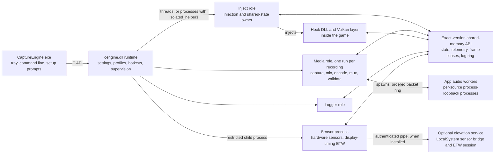

# Capture Engine technical overview

How CaptureEngine works inside. The [README](../README.md) is the user guide; the generated `config.ini` (source:
[captureengine/config.ini.template](../captureengine/config.ini.template)) is the complete option reference. This
page explains the internals behind both and is aimed at contributors, reviewers, and curious users.

- [Runtime and process model](#runtime-and-process-model)
- [Capture paths and GPU transport](#capture-paths-and-gpu-transport)
- [CFR media clock and exact A/V endpoints](#cfr-media-clock-and-exact-av-endpoints)
- [Audio pipeline](#audio-pipeline)
- [FPS limiter](#fps-limiter)
- [Overlay and frame generation](#overlay-and-frame-generation)
- [Hardware sensors](#hardware-sensors)
- [Graphics overrides](#graphics-overrides)
- [Encoding and FFmpeg patches](#encoding-and-ffmpeg-patches)
- [Diagnostics, crash dumps, and log privacy](#diagnostics-crash-dumps-and-log-privacy)
- [Security model](#security-model)
- [Build system](#build-system)
- [Testing](#testing)
- [Implementation notes](#implementation-notes)

## Runtime and process model

`cengine.dll` is the engine. `CaptureEngine.exe` is a thin tray frontend that drives it through the same C API the
[SDK](../sdk/README.md) publishes. One runtime runs per Windows session.

By default the runtime hosts its inject, media, and logger roles on threads inside the application's process.
`[Runtime] isolated_helpers=true` runs those roles as separate `CaptureEngine.exe` processes instead, so a crash inside
capture or encoding cannot take the application down. The sensor role, the per-application audio workers, and the
optional elevation service are always separate processes.



- **Frontend:** the tray icon and menu, command-line handling, and setup prompts. Everything else belongs to the
  runtime.
- **Runtime:** configuration and profile resolution, session identity, global hotkeys, the desktop recording
  indicator, and supervision of every helper role.
- **Inject role:** owns the discovery/shared-memory contract, injects the hook DLL, and publishes resolved
  per-process configuration.
- **Hook DLL:** intercepts graphics and frame-generation APIs inside the target, renders the injected overlay,
  publishes GPU frame leases, and runs latency-sensitive pacing locally. Vulkan uses an implicit layer instead (see
  [Implementation notes](#implementation-notes)).
- **Media role:** a fresh run per recording. It owns WGC/DXGI capture when selected, audio capture and mixing,
  encoding, muxing, post-write validation, and the recording's immutable diagnostic files. System-output and
  microphone sources are captured directly through WASAPI loopback and input devices.
- **Logger role:** drains the hook's shared log ring into the session's log files.
- **Sensor process:** CPU/GPU/RAM/VRAM telemetry, the LibreHardwareMonitor bridge, and the ETW screen-change sample
  ring, kept off the game's render thread.
- **App audio workers:** per-application process-loopback capture runs in disposable worker processes spawned by the
  media role. The AudioSes COM graph stays out of the long-lived process; only ordered packet records cross a private
  shared-ring/event boundary, and workers are recycled on target-process or activation lifecycle changes.
- **Elevation service:** an optional LocalSystem service. It hosts the LibreHardwareMonitor bridge and owns the
  display-timing ETW session, so CPU sensors and privileged tracing work without running CaptureEngine elevated. It
  accepts only fixed operations over an authenticated local pipe and stops after its last client leaves.

Thread-hosted roles receive their commands over an in-memory channel. With isolated helpers, each child gets a unique
duplex named pipe: only that pipe handle is inherited, the channel is restricted to the current user and SYSTEM, and
startup authenticates the exact child PID, role, protocol, sequence, and a random 128-bit nonce. The high-volume
shared-memory path is an exact, versioned ABI with size and layout fingerprints; mixed or stale binaries fail closed
instead of reading shifted frame or telemetry fields.

## Capture paths and GPU transport

- **WGC:** `Windows.Graphics.Capture`, the default non-injected window-capture path. It works with DirectFlip content.
  As a Windows limitation, a WGC session can make Windows switch to a software-rendered (DWM-composed) cursor; DXGI
  Desktop Duplication preserves the separate hardware cursor plane.
- **DXGI Desktop Duplication:** non-injected monitor capture with explicit source-delivery and duplication-pressure
  diagnostics. It can fall back to WGC for the same selected monitor when necessary.
- **Injected capture:** intercepts Present/swap-chain paths and publishes frames directly from the game process. The
  injected overlay and graphics overrides can also be used while WGC or DXGI remains the selected video source.

The principal capture-to-encoder paths keep frames GPU-resident wherever the API and driver allow it:

| Source API | Transport |
| --- | --- |
| D3D9Ex | Asynchronous GPU blit to shareable textures, imported by D3D11 |
| Classic D3D9 | Opportunistic native sharing; otherwise GPU→CPU readback staging or GPU-based WGC fallback |
| D3D10/11 | Shared D3D11 textures with query/fence and lease ownership |
| D3D12 | Shared resources/fences through the D3D11 hardware-frame handoff |
| Vulkan and DXVK | Encoder-owned KMT textures imported into Vulkan |
| OpenGL | GPU interop transport |

"GPU-resident" does not mean that every backend performs literally zero GPU copies. Format conversion, an
asynchronous GPU blit, or the final encoder-surface handoff can still be required. The important boundary is avoiding
a GPU-to-CPU readback followed by a CPU-to-GPU upload in the normal hardware path.

Classic D3D9 is where that boundary is commonly crossed. Classic `Direct3DCreate9` devices usually cannot create or
open shared resources on current drivers (NVIDIA x64/x86 probes return `D3DERR_INVALIDCALL` despite advertised caps),
so sharing is only opportunistic. When sharing fails, injected capture falls back to a D3D11 staging path: GPU
`StretchRect`, a deferred GPU→CPU readback after Present, `LockRect`, and a CPU→D3D11 upload. The readback is
deferred so Present itself is not blocked, but the per-frame CPU/GPU work remains, which is slow at high resolutions
and frame rates. Classic devices are deliberately not promoted to D3D9Ex, because that changes resource, reset,
presentation, and COM behavior. D3D9 under DXVK is captured through the Vulkan layer's GPU-resident transport instead.

## CFR media clock and exact A/V endpoints

The CFR media clock is authoritative. CaptureEngine does not derive file timing from whichever frames happened to
arrive:

- Output timestamps follow an immutable rational CFR grid. Matroska uses 1 microsecond timestamp precision, so 120 FPS
  intervals are represented as 8,333/8,334 microseconds instead of being quantized to 8/9 milliseconds.
- WGC and DXGI keep a bounded source-history reservoir and choose the nearest monotonic source frame for each scheduled
  content timestamp. Startup can briefly pre-fill the reservoir after prewarm so the first live seconds do not start
  with avoidable repeats. Inject capture uses the same nearest-timestamp principle with a smaller, GPU-native queue.
- Game hitches and mismatched source rates are represented by evenly placed repeats or decimation. A repeated desktop
  frame can still re-render a newly positioned hardware cursor.
- DXGI pointer-only acquisitions carry their own exact-QPC cursor history, so hardware-cursor motion stays smooth even
  when desktop content updates slowly. Cursor positions are selected at the same delayed content target as the frame,
  and repeats re-render the current cursor without full-frame copies, readbacks, or software-cursor substitution.
- Encoder overload never authorizes skipping CFR packet slots or accelerating audio. The scheduler preserves the
  output grid with cached repeats and, when safe, grid-matched historical frames. Measured fresh/repeat service time
  controls how aggressively recovery can run without creating another overload oscillation.
- Inject producers never wait in Present for a busy transport slot. A busy ring drops that source frame safely; the
  media scheduler closes the CFR slot using the last valid frame.
- Finalization derives every audio target from the final CFR frame count. The completed file is reopened, video packet
  coverage is checked for gaps, and every audio stream is decoded to verify the exact target sample count and
  identical endpoints across tracks.

Windows provides no API that can guarantee a recorder a fixed allocation of hardware video-encoding resources.
CaptureEngine preserves CFR and audio-sync correctness through transient pressure, but it cannot force a saturated
GPU, video engine, memory path, or driver queue to finish encoding on time. B-frames, lookahead, multipass encoding,
and higher-quality presets increase this pressure.

## Audio pipeline

System outputs are captured through WASAPI loopback and application audio through the Windows process-loopback API.
Each source has a timeline-aware float ring, and sources sharing a track are mixed before a soft-knee limiter that
leaves ordinary in-range samples bit-exact. Sparse application sources contribute source-local silence instead of
blocking a mixed track.

Audio is never cut, broadly pitch-shifted, or moved earlier to catch up with video pressure. An adaptive ingestion
reservoir absorbs delivery jitter without changing where samples land on the timeline. A very small source-clock
resampler correction is available only on a settled, healthy timeline and is capped at 0.05%; it is disabled during
startup protection, force drain, source loss, or encoder/timeline shortfall.

## FPS limiter

| Mode | Internal path |
| --- | --- |
| `basic` | Hook-local rational-QPC timer cadence |
| `reflex` | NVIDIA Reflex sleep-mode/low-latency integration, also in games that do not enable Reflex themselves; hands over to the game's own sleep loop once it is stable |
| `auto` | The game's own Reflex when the game has turned it on, `basic` otherwise |

The retired `fg_fallback` value is read as `basic`. With frame generation every mode limits the displayed frame rate.
Under FSR frame generation on DX12, the limiter paces the game's own frames where the game hands each frame to FSR
(half the configured rate at 2x, a third at 3x, on an exact grid) and leaves the spacing of displayed frames to AMD's
pacing; if the game stops presenting through FSR's swap chain, the limiter paces the displayed frames again.

Reflex integration resolves `NvAPI_D3D_SetSleepMode` and `NvAPI_D3D_Sleep` from `nvapi64.dll` and calls the original
entry points directly. CaptureEngine deliberately does not patch NvAPI code bytes, because some DLSS FG integrations
validate those prologues during Reflex setup. The driver's `minimumIntervalUs` is pushed to enforce the cap, and once
the game's own Reflex sleep loop is confirmed stable, pacing hands over to the game-owned sleep path.

The timer path uses a Bresenham-style rational QPC grid rather than rounding every frame to one integer tick interval.
The exact fractional remainder is accumulated instead of being truncated, so fractional target rates stay correct and
the cadence remains phase-locked to the CFR selector over long runs. Missing a deadline never produces a short
catch-up frame; the limiter skips whole grid slots, counts them, and continues on the next grid deadline.

Waiting is a hybrid sleep/spin strategy. A high-resolution waitable timer (Windows 10 1803+) is armed ahead of the
deadline by the measured p99 wake overshoot plus a small guard, between 50 microseconds and one scheduler tick; the
remainder yields and spins only for the final 50 microseconds. `timeBeginPeriod(1)` is requested only for the
`Sleep(1)` fallback when no high-resolution timer is available. In D3D10/11 the frame is handed to the GPU right
before the wait, so the GPU renders during the wait instead of idling.

Capture-sync recovery advances by whole grid slots until the next deadline has useful headroom, preserving phase with
the CFR selector after a hitch. In D3D10-12, a capture-synced frame is stamped with the moment the limiter presents
it, so the recorder sees an evenly spaced source. Re-entrant or concurrent Present calls cannot advance the same
cadence twice: one caller owns it and the others return without blocking.

## Overlay and frame generation

The overlay has custom renderers for DX9-DX12, Vulkan, and OpenGL, a custom font rasterizer, and precompiled shaders;
no third-party UI library is involved. The frame-time graph and optional PC-latency row use that renderer, as do the
benchmark countdown, live recording badge, and results card. Reflex/PCL markers improve frame correlation
(`PC Latency~`); without them, `Latency est.` combines measured Present-to-display timing with frame cadence. Both
account for dropped frames and the frame-generation base cadence and fail closed below the estimator's supported
rate; neither includes peripheral latency or physical display scanout. Layout and font rendering scale per monitor,
while presentation-color tracking keeps SDR, scRGB, and HDR10 output correct; texture format alone is not treated as
HDR.

**Display-change timing.** Frame time, FPS, 1% lows, variance, graph samples, and stutter state default to
`[Overlay] frametime_source=display_change`. The sensor process consumes graphics-kernel screen-change events through
ETW, from its own trace session or from one the elevation service owns when it is installed, and publishes a
lock-free ring that each DXGI and Vulkan overlay consumes independently, so generated frames and variable-refresh
scanout are included. NVIDIA scheduled-flip
announcements correct deferred flip completions, removing the presentation sawtooth that DLSS multi-frame generation
can otherwise show. NVIDIA's scheduled-flip provider has no registered manifest; CaptureEngine decodes it
positionally and revalidates every sample, so an unrecognized or moved field disables only that correction instead of
producing a wrong one. If the display stream is unavailable, denied, failed, or stale, the overlay falls back to
application `presentation` timing, which cannot reflect the real display cadence under frame generation or variable
refresh.

**Frame-time graph.** The vertical ceiling scales dynamically: it follows the recent average and minimum with at least
50% headroom above the average, a minimum 33 ms range so the 30 FPS threshold stays visible, and padding below the
lowest samples so the line stays vertically centered. The graph scrolls by drawn frames rather than sample arrival,
so it keeps moving smoothly under frame generation. The current ceiling is shown as a small scale marker that
refreshes at most every two seconds to avoid flicker.

**Frame generation.** DLSS Frame Generation integration observes NVIDIA Streamline and NGX through inline, wrapper,
dynamic-resolution, and direct-import seams. FSR Frame Generation integration observes FidelityFX context and
configuration state and the application's present-callback contract. NVIDIA Smooth Motion (driver-based frame
generation) is recognized as a present interposer. Explicit transition state machines and trace-replay tests cover
off, DLSS FG, and FSR FG switching without intentionally blanking the overlay, and the FG status line follows the same
state machines.

**Coexistence with other overlays.** The injected overlay stays out of a foreign Present-hook entry and composites
below the chain rather than re-patching it, which is how it coexists with Steam and RTSS (validated on DX12) and is
intended to cover other established overlays as well. With an object-wrapping proxy (for example a proxy
`dxgi.dll`), CaptureEngine resolves the system DXGI factory, so its hook lands on the real swap chain beneath the
wrapper rather than on the proxy's object.

## Hardware sensors

The LibreHardwareMonitor bridge is compiled into `CaptureEngine.exe`: the sensor process launches the same executable
in a contained bridge role that hosts the .NET Framework runtime already present on Windows and drives the managed
library directly, so no script, interpreter, or additional binary is involved. No LibreHardwareMonitor code enters the
game or the hook DLL. When the elevation service is installed, the service hosts the bridge instead, which lets the
PawnIO-backed CPU rails be read without an elevated CaptureEngine; if the service is unavailable, the local bridge
takes over and reports CPU rails it cannot read as unavailable.

The build fetches the four LibreHardwareMonitor runtime files from the official
[v0.9.6 release](https://github.com/LibreHardwareMonitor/LibreHardwareMonitor/releases/tag/v0.9.6), verifies the
archive against a pinned SHA-256 digest and byte size, extracts only those four names, and refuses any Microsoft
dependency that is not Authenticode-signed. Other files from that release (GUI, PDBs, storage/SMBus helpers) are
deliberately not packaged. The build also verifies and packages the official Microsoft-signed `PawnIO_setup.exe`;
before running it, CaptureEngine re-verifies its signature and pinned SHA-256. Licenses are recorded in
[LibreHardwareMonitor_NOTICE.txt](../tools/licenses/LibreHardwareMonitor_NOTICE.txt) and
[PawnIO_NOTICE.txt](../tools/licenses/PawnIO_NOTICE.txt).

## Graphics overrides

### Anisotropic filtering and samplers

Forced AF follows each graphics API's native sampler model. It is not one generic per-draw replacement hack:

| API | Implementation |
| --- | --- |
| D3D6-9 | Reconciles mutable texture/sampler state on state changes, config changes, and state-block application |
| D3D10 | Modifies immutable sampler descriptors once at creation and retries the original descriptor if rejected |
| D3D11 | Uses pixel-shader/SRV-aware dirty-slot replacement; a clean draw performs only a version/dirty check |
| D3D12 | Covers dynamic samplers plus static samplers in root signatures 1.0-1.2 at creation time |
| Vulkan | Applies policy at `vkCreateSampler`, clamps to device limits, and transactionally retries the original |
| OpenGL | Reconciles texture/sampler parameter, storage, mip-generation, and cached bind events without a draw hook |

Safe mode preserves structurally special samplers such as comparison/reduction, border, fixed-LOD, non-mipmapped, and
other API-specific unsafe cases. Aggressive mode broadens ordinary material coverage without opting protected sampler
families in. D3D10, D3D12, and Vulkan have no bind/draw overhead after sampler creation; legacy APIs and OpenGL do only
event-driven bookkeeping. Decisions, retries, bootstrap failures, and summaries are rate-limited in the debug logs.

`[Graphics] nv_lod_spread_fix=on` forces the NVIDIA driver's `FERMI_UNOPT_LOD_SPREAD` setting on in OpenGL and Vulkan,
where NVIDIA's default drops the LOD spread to zero and degrades filtering with a negative LOD bias. The Vulkan layer
applies it after instance creation and before device creation, so DXVK or native Vulkan cannot initialize first.

### Unreal Engine 5 CVars

The `[UE5]` options are process-local overrides that persistently redirect validated game-thread/render-thread CVar
shadows in memory; they never edit `Engine.ini` or other game files.

- `force_ray_reconstruction=on` selects an existing NVIDIA plugin's `r.NGX.DLSS.DenoiserMode=1` path.
  `ray_reconstruction_optimal_settings=off|light|medium|high|full` also applies the documented Lumen, virtual-shadow,
  and MegaLights quality bundle as a strict ladder: the cheaper levels carry everything that costs no GPU time and
  add sampling density only as the level rises (`on` is an alias for `full`). Neither option invents missing RR inputs,
  spoofs driver support, or blocks ordinary DLSS SR fallback. A compatible `nvngx_dlssd.dll` can still be supplied
  separately with `[DLSS] dlss_rr_dll_path`.
- `depth_of_field=off|on` writes `r.DepthOfFieldQuality`. `dlss_super_resolution=on` sets the NVIDIA plugin's own
  `r.NGX.DLSS.Enable` and the engine levers that route rendering through the third-party temporal upscaler
  (`r.NGX.Enable`, `r.TemporalAA.Upscaler`, `r.AntiAliasingMethod=2`), with `dlss_super_resolution_quality` selecting
  the mode through UE's screen percentage. `hdr_output`, `hdr_peak_luminance`, `hdr_paper_white`, `hdr_ui_luminance`,
  `hdr_min_luminance`, and `hdr_color_gamut` drive `r.HDR.EnableHDROutput` and the `r.HDR.Display.*`/`r.HDR.UI.*`
  parameters in the nits the engine documents. None of them can add a missing plugin, invent HDR output on an SDR
  display, or create depth of field a game never configured.
- `disable_post_processing_effects=on` disables UE's built-in sharpen, film grain, vignette, motion blur, and chromatic
  aberration through dedicated CVars and show flags without lowering `r.Tonemapper.Quality`;
  `tonemapper_sharpen=0..10` restores a chosen tonemapper sharpen strength. CaptureEngine deliberately does not
  disable all game-authored post-process materials, because those can also implement gameplay, damage, underwater, and
  accessibility effects.
- `custom_cvar_overrides` accepts a comma-separated list of typed `CVar=value` entries that take precedence over the
  presets and dedicated options for that process.

Every exact injected CVar and value is listed beside these settings in the generated `config.ini`.

### Streamline 1.x-to-2.x upgrade

`[DLSS] streamline_upgrade=on` stops treating `streamline_dll_path` as a DLL substitution and runs that folder's
Streamline 2.x runtime as a second, CaptureEngine-owned runtime beside the game's own 1.x one. CaptureEngine repoints
the game's `sl.interposer` import slots and translates 1.x calls to 2.x, including the 1.x Reflex markers and the
per-feature constant layouts, which NVIDIA never published and which were therefore measured from a real session. The
takeover must happen before the game creates its device; the game's 1.x runtime is then shut down, so exactly one
initialized runtime remains. The 2.x plugin set is pinned to the configured folder with over-the-air updates off.
Nothing on disk is renamed or patched, activation is all-or-nothing, and anything not verified is refused and logged
rather than approximated. It is validated in The Witcher 3 with DLSS super resolution and 4x multi-frame generation.

### Third-party DLL loading

ReShade, OptiScaler, and Special K load in the order Special K, ReShade, OptiScaler. Before each tool after the first,
CaptureEngine waits for the Windows loader work queue to drain and suspends the other process threads during the load,
because the tools' init threads perform their own DLL loads and back-to-back `LoadLibrary` calls deadlock the loader
otherwise.

## Encoding and FFmpeg patches

Video/audio encoding and Matroska muxing use FFmpeg (`libavformat`, `libavcodec`, `libavutil`, and `swresample`).
Hardware-frame paths are available for NVENC, AMD AMF, and Intel Quick Sync/oneVPL. Backend behavior is explicit
rather than emulated:

- NVENC HEVC/AV1 can split each frame across multiple physical encoder engines while still producing one ordinary
  stream (`[NVENC] split_encode=0..4`); H.264 never splits.
- Quick Sync derives its encoder and dynamic-frame context from the exact capture D3D11 device and maps surfaces
  directly, with no VAAPI layer or CPU frame transfer. AMF consumes the D3D11 hardware pool directly.
- Media Foundation is a deliberate NV12/SDR compatibility fallback and does not carry HDR. H.264 HDR fails closed;
  HDR sources require HEVC or AV1.
- HDR signaling is one explicit contract rather than being inferred from an FP16 or 10-bit texture: BT.2020-NCL/PQ,
  limited range, top-left co-sited 4:2:0 (Rec.2100 chroma phase), and a nominal peak (default 1000 nits,
  `[Video] hdr_nominal_peak_nits`) written consistently to the codec context, frames, container, and HEVC/AV1 headers.
  AV1 NVENC's unsafe SMPTE ST 12-1 timecode path is disabled.
- HDR video writes BT.2020-NCL P010 directly rather than relying on fixed-function conversion. The HDR-to-SDR path is
  an actual tone and gamut map calibrated from the Windows SDR-white setting.

See [tools/patches/ffmpeg/README.md](../tools/patches/ffmpeg/README.md) for the exact patches:

- Configurable Matroska timestamp precision, including duration/default-duration scaling and safe cluster rollover
- Deterministic NVENC lookahead/AQ disablement, capability-aware B-reference resolution, additional picture-type
  mapping, and an AV1 B-frame maximum-QP control

## Diagnostics, crash dumps, and log privacy

Each run receives a timestamped session directory under `logs/` with a runtime manifest, per-role logs, performance
metrics, and immutable recording-specific media logs and manifests, so a later recording cannot overwrite the evidence
for an earlier one. Recordings are staged under a reserved name and renamed to their final name only after the mux
trailer is written, the duration is positive, and at least one video packet exists; interrupted or failed recordings
therefore never publish a partial or header-only file. Each recording carries an immutable manifest with its final
status, health state, and timeline debt.

The hook publishes bounded log records through a lock-free shared ring to the logger role. Hot paths use rate-limited
state-transition, ownership, and failure diagnostics rather than unbounded per-frame noise. Depending on the configured
log level, the evidence can reconstruct:

- capture-backend selection and DXGI-to-WGC fallback history
- source starvation versus copy-pool, GPU-fence, media-CPU, mux, or encoder pressure
- CFR selection, repeats, phase lock, visual debt, timer overshoot, and limiter mode changes
- audio source epochs, delivery headroom, reservoir changes, drift correction, mixing, and final sample accounting
- DLSS/FSR state transitions, swap-chain/queue ownership, overlay routing, and slow DX12 Present/command-list phases
- post-mux packet coverage, codec padding, decoded audio endpoints, and finalization failures

**Crash and freeze handling.** Dumps are written by an out-of-stack worker with rich thread, unloaded-module, handle,
process/thread, and memory metadata where the target permits it, falling back to more compatible dump types if
necessary. The injected hook has a freeze watchdog that scales its timeout to the detected engine/runtime class (for
example Unreal Engine 5 or DLSS frame generation) and can capture the monitored thread's context for hangs, blocking
dialogs, and selected GPU-removal paths without terminating the game. Successful external `MiniDumpWriteDump` calls
made by a game's or runtime's own crash handler are mirrored into the active session, covering crash families that
bypass CaptureEngine's unhandled-exception filter; repeated identical external dump storms terminate the crashing
process with a dedicated exit code instead of producing an endless dump sequence. The crash handler also covers
recoverable execute faults such as lazy trampoline-pool DEP faults.

**Symbols.** Windows builds emit PDBs, and every session snapshots the matching CaptureEngine PE/PDB set beside its
dumps, so a dump remains symbolizable after a newer build has replaced the installed binaries. CDB, WinDbg, or Visual
Studio can resolve both those archived symbols and Microsoft system symbols. DX12 device-removal diagnosis can
additionally use opt-in DRED breadcrumbs/page-fault data and the built-in command-queue/overlay timing diagnostics.

**Log privacy filter.** Every funnel that writes a log line (runtime logging, the hook's atomic file and shared-ring
fan-out, the Vulkan layer's early/layer/incompatible-discovery reports, and the session manifest) passes through one
shared filter. It masks Windows account components inside `\Users\<account>` path prefixes (length-preserving, so
fixed-capacity log buffers can never overflow) and collapses user-configured recording and screenshot output paths to
their root prefix plus file name, so a shared log shows `H:\...\capture_*.mkv` rather than private folder layouts.
Hardware model, GPU driver details, game process names, PIDs, and timestamps stay in the logs deliberately: they carry
high diagnostic value without being directly identifying. The filter is best-effort pattern matching over known path
shapes, not a guarantee, and crash dumps intentionally retain full module paths and raw memory.

## Security model

- **DLL loading:** CaptureEngine's own runtime DLLs load only from the application directory, System32, and one
  private runtime directory, never from the current directory or `PATH`. Configured user DLLs under `[DLSS]` and
  `[ThirdParty]` and the packaged LibreHardwareMonitor/PawnIO files are explicit, separately validated exceptions.
- **Child processes:** children inherit only explicitly listed handles; private channels are authenticated per child
  (see [Runtime and process model](#runtime-and-process-model)).
- **Untrusted input:** configuration, IPC, elevation and sensor protocols, runtime arguments, and settings edits are
  parsed fail-closed and fuzz-tested (see [Testing](#testing)).
- **Injection-time signature check:** the runtime re-verification performed before injecting a hook DLL is advisory in
  current releases. Only `--production` builds (`CE_PRODUCTION_BUILD=1`) enforce a valid Authenticode signature, and
  stable release binaries are currently built without it. Until Authenticode signing ships, injection-time trust
  derives from the release attestations and reproducible local builds, not from the runtime signature check.

Security vulnerabilities should be reported privately through the [security policy](../SECURITY.md).

## Build system

[build.py](../build.py) is the single orchestration entry point for dependency preparation, compilation, testing,
analysis, binary verification, and packaging. It is a small compatibility facade; its ordered source fragments live
under `tools/build/`. On Windows it manages a project-local MSYS2 `clang64` environment, which supplies the package
manager, Clang/LLD, build tools, headers, and libraries. MSYS2 is only the controlled build environment; CaptureEngine
itself is built as native Windows PE executables and DLLs.

The build covers the x64 application and `cengine.dll`, the hook DLLs (x64 and the x86 compatibility hook),
MediaEngine, the Vulkan layer and its gate library (x64 and x86), the elevation service, the installer and uninstaller,
the SDK folder, shaders and resources, the native graphics test applications, and the unit-test binaries. Shipping
files are staged under `installed/captureengine`; validation-only programs remain under `installed/testapp`. After
binary verification, a product build writes `build/packages/captureengine-setup-<version>.exe`. With
`--portable-archives` it also writes `captureengine-<version>.7z`, `testapps-<version>.7z`, and (native Windows)
`ffmpeg-corresponding-source-<version>.7z`; older packages of the same kind are removed.

The product archive contains a clean `captureengine/` folder without local logs, captures, backups, stale files, or
the current user configuration, plus the pinned LibreHardwareMonitor runtime files and PawnIO installer under
`plugins/LibreHardwareMonitor`. The `testapps` archive contains only first-party executables/PDBs plus a runtime note;
it does not redistribute the FSR, Streamline, DLSS/NGX, Reflex, or driver DLLs staged for local validation. The
source archive contains the exact pinned, locally patched FFmpeg tree, its release build inputs, and verified source
archives for the bundled LGPL libiconv runtime.

Dependency handling is reproducible and fail-closed. The MSYS2 bootstrap is authenticated using its detached
signature and a pinned signing key. Source packages and upstream archives are checked against pinned signatures,
fingerprints, and SHA-256 hashes, then the FFmpeg dependency closure and the customized FFmpeg are built into a
private prefix, from which alone the FFmpeg runtime DLLs are staged. Unexpected PE imports, missing licenses, a changed
patch/configuration fingerprint, or an unverifiable dependency cause a rebuild or a hard failure instead of silently
using an arbitrary system copy.

Incremental builds are content-validated rather than timestamp-based: an object is reused only when its source,
compiler binary, flags, dependency information, and project-header contents still match. Product binaries are
relinked with the exact new build identity, while reusable test links additionally validate every input and the
output hash. The build emits `compile_commands.json`, uses strict floating-point semantics for sensitive audio,
timing, and color-conversion code, and verifies PE architecture, import closure, Control Flow Guard and other
mitigations, writable/executable section separation, shaders, CodeView records, and matching PDBs.

Common loops:

```powershell
# Fast edit/test loop for one suite or test
python build.py --incremental --tests-only --run-tests --gtest-filter=<suite-or-test> --skip-updates --concise

# Closing gate for a change: build, verify, test, and package the installer
python build.py --incremental --run-tests --skip-updates --concise

# Clean product build, for dependency/toolchain changes or suspected stale artifacts
python build.py --skip-updates --concise

# Static release-candidate gate; add --verify-clean for build-system, toolchain, ABI, or gate-policy changes
python build.py --verify --skip-updates --concise
```

`--verify` is a nested all-in-one gate, not an extra step after the closing gate: it performs a content-validated
product build, the full native and Python test suites, content-addressed clang-tidy and file-size ratchets, and
isolated ASan/UBSan validation. `--verify-clean` forces a strict clean product rebuild. On a cache miss, the sanitizer
build runs concurrently with the product build in separate output roots. `--skip-updates` keeps routine development on
the already verified dependency set; stale or missing outputs are still rebuilt. `--concise` keeps the terminal
readable while preserving complete commands and subprocess output in the detailed build log. A plain
`python build.py` may refresh MSYS2 and source-built dependencies when required. The full option reference is
`python build.py --help`.

## Testing

GoogleTest covers capture scheduling, audio timing and codecs, FPS limiting, frame-generation transitions,
shared-memory/IPC validation, graphics overrides, crash-dump policy, mux invariants, configuration parsing,
display-change timing and correlation policy, benchmark state/statistics and HTML report generation, hardware-sensor
selection, PawnIO setup policy, the installer, and the runtime's role threads.

Synthetic x86/x64 test applications cover every supported graphics API (DirectDraw, D3D6-D3D12, OpenGL, Vulkan) and
every frame-generation path (FSR FG, DLSS FG, and DX12/Vulkan FG switching), plus a deterministic A/V stimulus
harness. Real-game coverage for DirectDraw and D3D6-D3D8 is still thin; Gothic II (DirectDraw/D3D7) is the main
real-game target so far.

Robustness is exercised beyond unit tests: libFuzzer harnesses fuzz the configuration parser, the IPC deserializer,
the elevation and hardware-sensor protocols, runtime configuration arguments, settings edits, and PE import/export
parsing against committed seed corpora (`build.py --run-fuzz`). DX12 frame-generation transitions are validated with
trace-replay and transition-sequence tests, and the A/V sync matrix decodes finished recordings and correlates content
across the entire duration rather than only checking endpoints. ASan/UBSan validation runs in isolated output roots,
and clang-tidy/file-size findings are content-addressed and ratcheted so regressions cannot silently return. The
verification pipeline also checks tool self-tests, PE hardening/architecture, import closure, and PDB availability.

## Implementation notes

- **Interception:** the hook stack is custom rather than MinHook-based: IAT patching, vtable hooks, and
  trampoline-based inline detours for x64/x86 with an instruction-length decoder and deep hooks that wrap external
  JMP patches. Trampolines can be published before a target becomes live, and D3D9-D3D12/DXGI COM wrappers forward
  explicitly so raw vtable hooks cannot run the same logic twice.
- **Vulkan:** capture and overlay run as a real implicit Vulkan layer (`VK_LAYER_CE_overlay`, x86 and x64), registered
  per-user or for all users in both registry views, bridged into the same shared-memory/IPC contract as the hook DLL.
  The registration stays in place after CaptureEngine exits, because the Vulkan loader builds a process's layer chain
  only once, inside `vkCreateInstance`; a game started before CaptureEngine could otherwise never get an overlay. The
  manifest names a small gate library (`VK_LAYER_CE_gate.dll`) that imports only system DLLs, declines every process
  that is not an injection target, and loads the full layer only for admitted ones. Setting the environment variable
  `DISABLE_CE_VULKAN_LAYER=1` keeps the layer out entirely. DXVK transport uses encoder-owned KMT textures with no CPU
  round trip.
- **Shared-memory ABI:** the layout is versioned and every field offset is mixed into a fingerprint hash, so mixed or
  stale binaries fail closed instead of reading shifted fields. Configuration reloads use sequence locks; the inject
  frame ring publishes only the longest contiguous completed prefix, so out-of-order GPU work can never recycle
  encoder-owned textures; the log path is a bounded lock-free ring.
- **HDR color pipeline:** presentation color is tracked from swap-chain state (`SetColorSpace1`, `VkColorSpaceKHR`)
  instead of texture formats; overlay HDR10 draws transform Rec.709 to Rec.2020 before PQ using the Windows SDR-white
  calibration.
- **Scheduling:** capture/encoder workers use checked MMCSS QoS, D3D11 device priority is persisted, process
  scheduling priority resolves against the adapter's actual HAGS state, and CaptureEngine's processes opt out of
  Windows 11 power throttling to avoid jitter.
